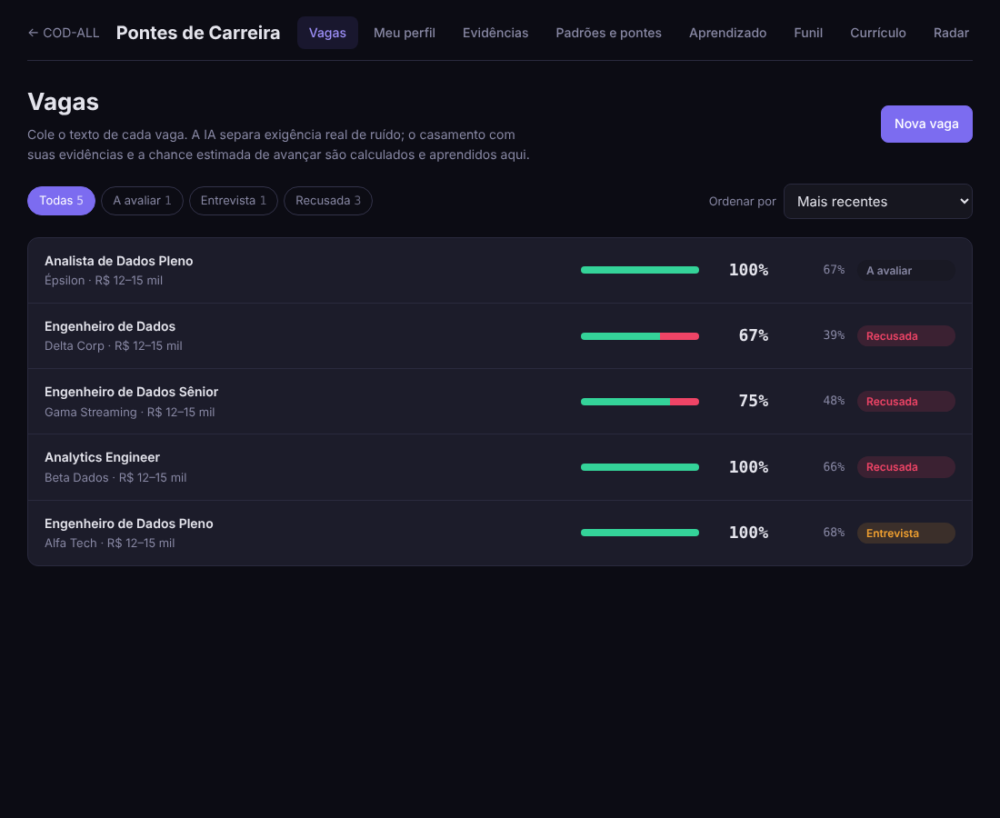
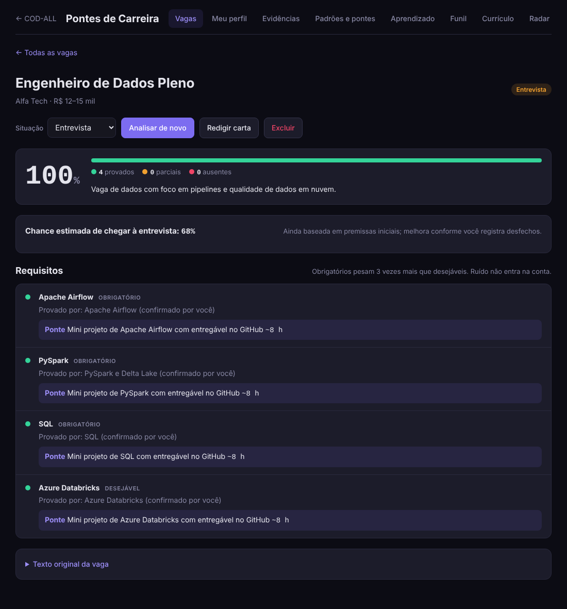
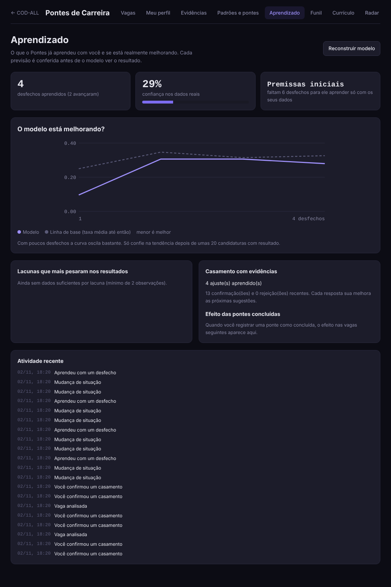
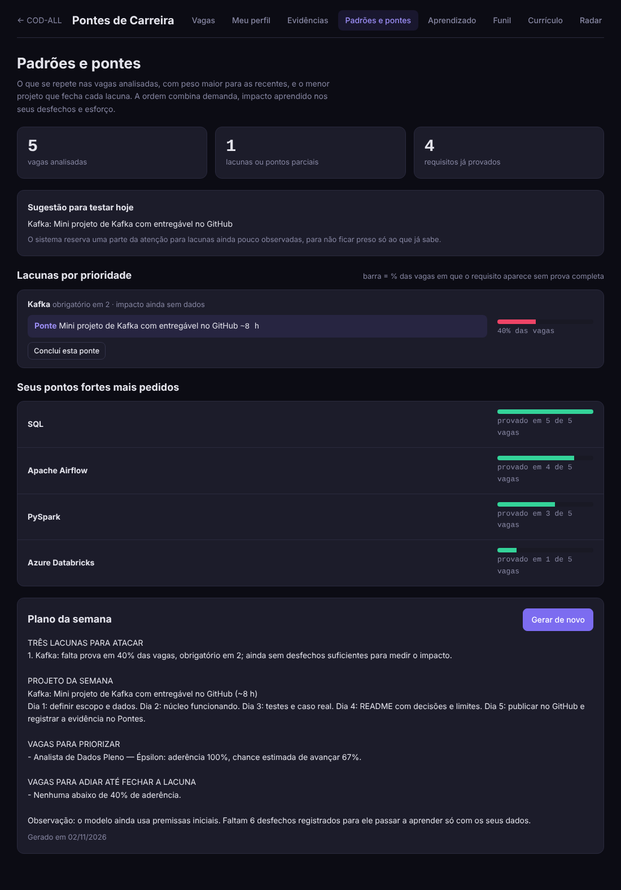
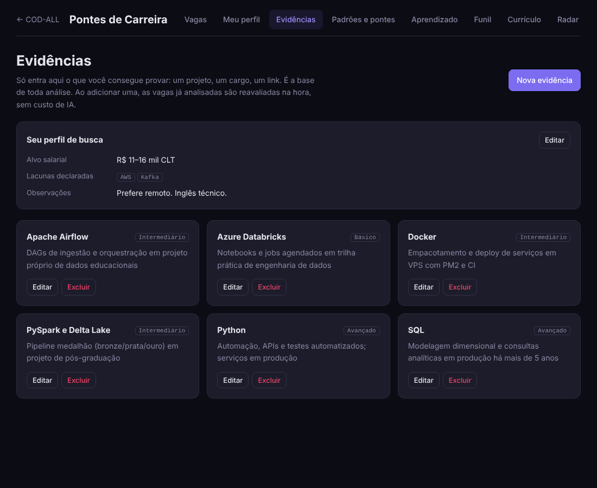
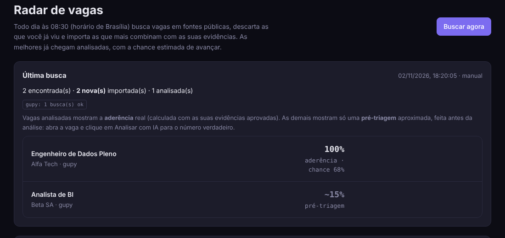
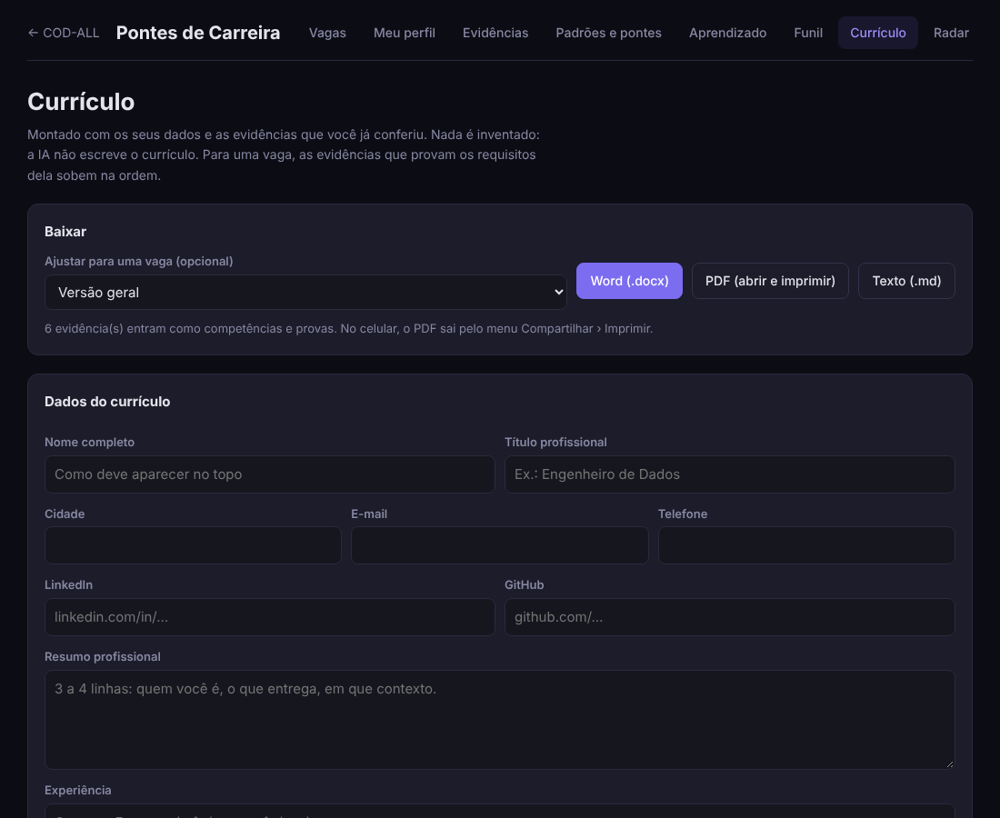
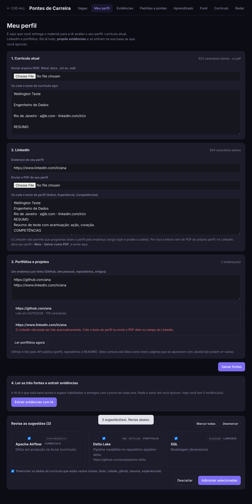
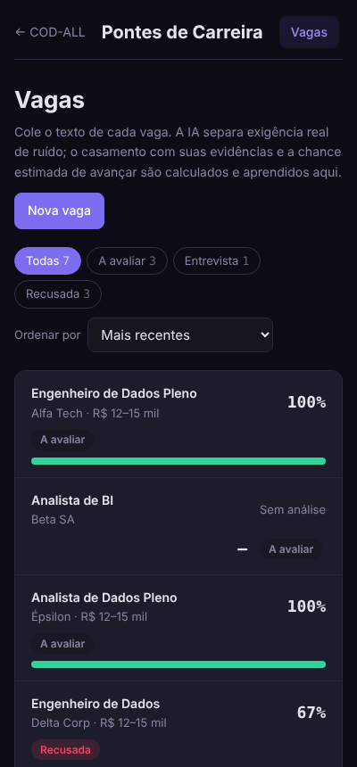

# Pontes de Carreira

> Agente de transição de carreira que cruza vagas reais com **evidências reais do meu perfil**, mostra lacunas e "pontes", e **aprende online** com os resultados das minhas candidaturas.

Projeto pessoal em Node.js/Express, SQLite e JavaScript puro no front-end, criado por **Wellington Gois** (engenheiro de dados) com apoio do Claude (Anthropic) como par de programação. Nasceu como módulo de um assistente maior e foi extraído para este repositório. Histórico de decisões em [HISTORICO.md](docs/HISTORICO.md).

*English summary at the [end](#english-summary). Full write-up: [docs/ARTICLE-EN.md](docs/ARTICLE-EN.md).*

## O problema

Ao migrar de área, o candidato costuma ouvir "faltou experiência" sem saber **o quê** especificamente. Ferramentas de currículo e IA genérica tendem a embelezar o perfil ou inventar competências, o que não ajuda numa entrevista técnica.

## A solução

1. **Vagas** — cola o anúncio (ou o radar importa); a IA extrai os requisitos.
2. **Evidências** — cada habilidade só conta se tiver uma prova que eu mesmo aprovei (projeto, link, resultado). A IA propõe, eu confirmo.
3. **Aderência** — cada requisito fica verde (provado), amarelo (parcial) ou vermelho (lacuna).
4. **Padrões e pontes** — as lacunas que mais se repetem no mercado, priorizadas, e o que estudar/construir para fechá-las.
5. **Aprendizado** — registro cada resultado (entrevista, recusa, sem retorno) e o modelo ajusta a chance estimada de avançar.
6. **Currículo e radar** — currículo sob medida por vaga (.docx, HTML para PDF, Markdown) e busca diária às 08:30 em fontes públicas.

| Vagas | Análise de uma vaga |
|---|---|
|  |  |

> Todas as imagens usam **dados de demonstração**, não candidaturas reais.

## Princípio central: a IA não prova nada

| Quem | Faz | Não faz |
|---|---|---|
| LLM | extrai requisitos, redige carta, **propõe** evidências | marcar requisito como atendido |
| Matcher local | sugere "provável" por similaridade | marcar verde sozinho |
| Eu | aprovo cada evidência | — |

Um requisito só fica verde com uma evidência **aprovada por mim**. Currículo, LinkedIn e portfólio servem de contexto para a IA, nunca de prova.

## Machine learning (sem dependências externas)

Implementado do zero em [`src/pontes/ml`](src/pontes/ml):

| Técnica | Para quê |
|---|---|
| TF-IDF (palavras + trigramas de caracteres) | casar requisito ↔ evidência, tolerando variações de escrita |
| Ajustes por par aprendidos | confirmar/rejeitar uma sugestão muda a similaridade daquele par |
| Regressão logística online (SGD + L2) | prever a chance de a candidatura chegar a entrevista |
| Pesos a priori | começa com "premissas iniciais" até haver 10 desfechos |
| Avaliação prequential (testar e depois treinar) | mede o acerto honestamente, contra a taxa-base (Brier) |
| Demanda de mercado com meia-vida de 45 dias | vagas recentes pesam mais |
| Thompson sampling | escolhe qual lacuna estudar, equilibrando explorar × aproveitar |
| Reconstrução determinística (`reconstruir`) | reproduz o modelo a partir do histórico de eventos |

Rótulos: entrevista/oferta, ou recusa em RH/técnica/final = 1; recusa na triagem = 0; sem retorno após 30 dias = 0 com peso 0,5.




## Arquitetura

```
server.js                servidor mínimo (login por senha em variável de ambiente)
public/js/pontes.js      front-end (abas: Vagas, Meu perfil, Evidências, Padrões, Aprendizado, Funil, Currículo, Radar)
src/routes/pontes.js     API REST (/api/pontes/*)
src/pontes/service.js    regras de negócio, agendamento (node-cron, 08:30 America/Sao_Paulo)
src/pontes/store.js      SQLite (better-sqlite3), tabelas pontes_*
src/services/aiProvider.js   provedores de IA por variável de ambiente
src/pontes/llm.js        chamada ao LLM + extração/reparo de JSON truncado
src/pontes/ml/           TF-IDF, matcher, modelo de desfecho, mercado, priorização
src/pontes/radar.js      busca diária, pré-triagem, deduplicação
src/pontes/{paginas,jobgether,fontes}.js   leitores de fontes, robots.txt, proteção SSRF
src/pontes/curriculo.js  .docx (zip escrito à mão), HTML e Markdown
teste/pontes/            38 testes (node:test)
```



## Radar diário de vagas

Todo dia às 08:30 busca em **Gupy** (Brasil), **Remotive** e um feed do **Jobgether**, remove duplicatas, descarta estágio/trainee, pontua cada anúncio contra minhas evidências e importa as melhores; as primeiras são analisadas pela IA.

Conduta com as fontes:
- respeita `robots.txt` (regra mais específica vence, `Crawl-delay` obedecido) e se identifica no User-Agent;
- poucas requisições por dia, com pausa;
- bloqueia endereços de rede interna (proteção SSRF);
- **LinkedIn, Indeed e Glassdoor são recusados** porque os termos de uso proíbem a leitura automática;
- sites sem dados `JobPosting` (ex.: BeBee) são reportados como incompatíveis, sem tentar contornar.



## Currículo e perfil

 

Em mobile:



## Limites (assumidos, não escondidos)

- **Poucos dados**: o modelo online só é confiável após ~10 desfechos; até lá a tela diz "premissas iniciais". Ele estima, não promete.
- **Pré-triagem do radar é local e barata**; a aderência real só existe depois da análise da IA. A tela rotula as duas coisas separadamente (descobri isso por um erro de percentual, ver o histórico).
- **LinkedIn não é lido automaticamente**: exige PDF ou texto colado.
- A pré-triagem não enxerga visto/residência; há uma penalidade heurística por bloqueio geográfico.
- Fontes públicas mudam: o endpoint da Gupy já mudou durante o projeto, por isso há fallbacks e status por site.

## Como rodar

```bash
git clone https://github.com/wellgois/pontes-de-carreira && cd pontes-de-carreira
npm install
cp .env.example .env     # defina PONTES_PASSWORD (sem senha padrão) e ao menos uma chave de IA
npm start                # http://127.0.0.1:3000
```

Sem chave de IA, o app abre, mas a extração de requisitos e a carta ficam indisponíveis; o restante (ML, radar, currículo) roda localmente.

## Como rodar os testes

```bash
npm install
npm test     # 38 testes: ML, serviço, radar, fontes, robots.txt
```

Como usar: [docs/USO.md](docs/USO.md).

## English summary

**Pontes de Carreira** ("Career Bridges") is a career-transition agent I built on my own VPS assistant. It extracts requirements from job postings with an LLM, but a requirement counts as met **only when backed by evidence I approved**, so the AI never invents skills. It surfaces recurring gaps, suggests what to build/study (Thompson sampling), and learns from my application outcomes with an **online logistic regression written from scratch** (SGD + L2, prequential evaluation against a base-rate baseline). A daily 08:30 radar pulls jobs from public sources (Gupy, Remotive, Jobgether feed), honoring `robots.txt` and refusing sites whose terms forbid scraping. Stack: Node.js/Express, SQLite, vanilla JS, node-cron; 38 automated tests. Limits are stated openly: small-sample ML, local pre-screening vs AI analysis.
